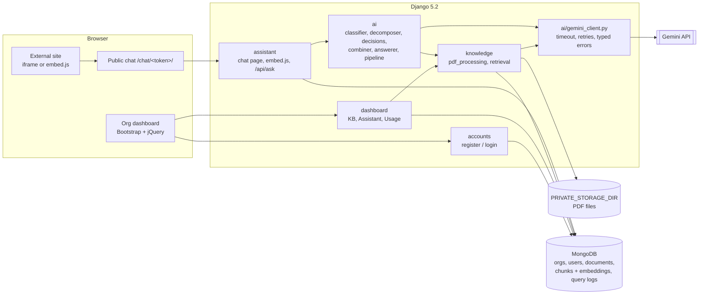
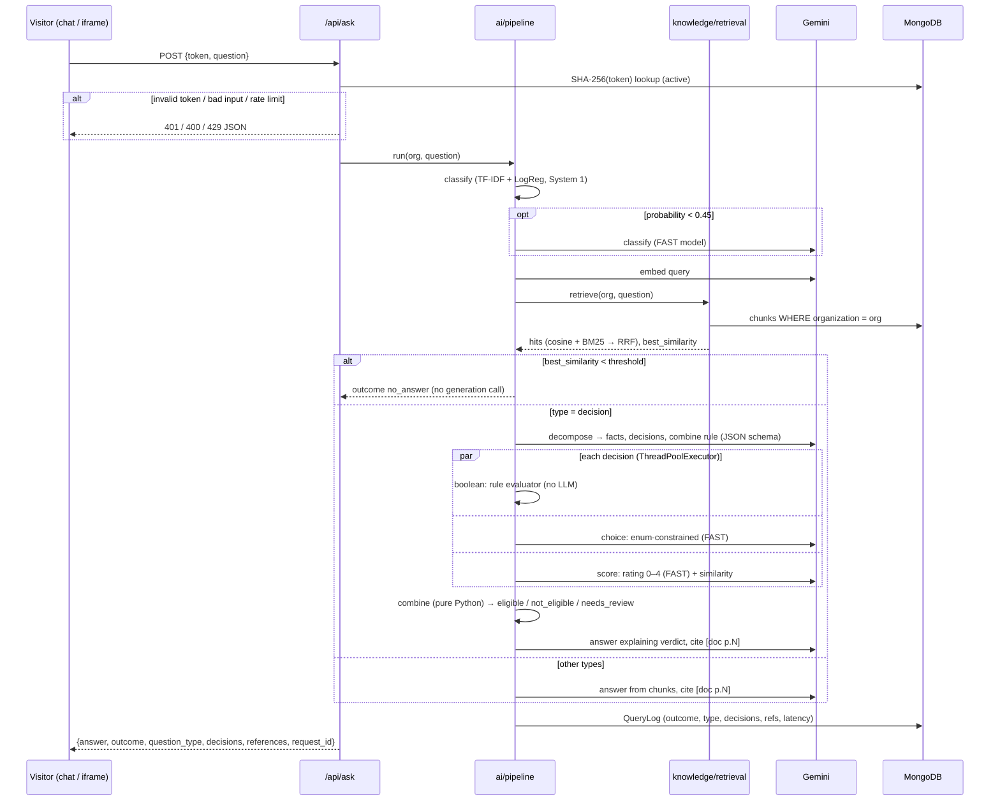

# AI Knowledge & Decision Assistant

A multi-tenant SaaS MVP. An organization uploads PDFs and gets an assistant it can embed on its own site.
The assistant answers visitor questions from those documents, cites the page it used, and for eligibility-style
questions returns a structured verdict (`eligible` / `not_eligible` / `needs_review`).

Stack: Python 3.11+ (tested on 3.13), Django 5.2, MongoDB via `django-mongodb-backend`, Google Gen AI SDK (Gemini),
pypdf, rank-bm25, numpy, scikit-learn, pydantic v2, Bootstrap 5 + jQuery (CDN, no build step).

---

## 1. Setup

### Prerequisites
- Python 3.11–3.13. Some wheels are not yet available for newer versions.
- MongoDB, either of these:
  - **Local**: `mongod` 7.0+ (8.x works). On macOS: `brew tap mongodb/brew && brew install mongodb-community && brew services start mongodb-community`.
  - **Atlas**: a free M0 cluster. Copy its `mongodb+srv://…` connection string and allow your IP.
- A Gemini API key from [Google AI Studio](https://aistudio.google.com/apikey).

### Why MongoDB
Every chunk is a document that holds its text, page number, organization and its 768-float embedding as a native
array. Query logs store decisions and references as embedded JSON. Both map to documents directly, with no join
tables and no serialized blobs. The same chunk documents can also back Atlas `$vectorSearch` later without a schema change.
Django's ORM, auth, sessions and migrations all run on MongoDB through the official backend.

### Install and run
```bash
python3.13 -m venv .venv && source .venv/bin/activate
pip install -r requirements.txt
cp .env.example .env            # then edit: DJANGO_SECRET_KEY, GEMINI_API_KEY, MONGODB_URI
python manage.py migrate        # creates the collections and indexes in MONGODB_DB
python manage.py runserver      # http://127.0.0.1:8000 → register an organization
```

### Seed demo data (needs `GEMINI_API_KEY` for embeddings)
```bash
python manage.py seed_demo      # generates 4 PDFs into demo/sample_pdfs/, creates 2 orgs, prints logins + assistant URLs
```
Demo orgs: **Northbridge University** (scholarships, student handbook) and **Acme Corp** (leave and expense policies).
Password for both: `Demo-Assistant-2026`. Running it again deletes and recreates both demo orgs.

### Environment variables (`.env`, template in `.env.example`)
| Variable | Default | Purpose |
|---|---|---|
| `DJANGO_SECRET_KEY` | — (required) | Django secret key |
| `DJANGO_DEBUG` | `false` | Debug mode |
| `DJANGO_ALLOWED_HOSTS` | empty | Comma-separated host list |
| `MONGODB_URI` | `mongodb://localhost:27017` | Local mongod or Atlas URI |
| `MONGODB_DB` | `knowledge_assistant` | Database name (tests use `test_<name>`) |
| `GEMINI_API_KEY` | empty | Google AI Studio key |
| `GEMINI_LLM_MODEL` | `gemini-2.5-flash` | Decomposition and answer generation |
| `GEMINI_FAST_MODEL` | `gemini-2.5-flash-lite` | Classifier fallback, choice and score decisions |
| `GEMINI_EMBED_MODEL` | `gemini-embedding-001` | Embeddings |
| `GEMINI_EMBED_DIM` | `768` | Embedding dimension |
| `GEMINI_TIMEOUT_SECONDS` | `30` | Per-call timeout |
| `PRIVATE_STORAGE_DIR` | `<project>/private_storage` | Uploaded PDFs (never served) |
| `RETRIEVAL_MIN_SIMILARITY` | `0.55` | Grounding gate threshold |
| `ASK_RATE_LIMIT_PER_MINUTE` | `20` | Per-IP limit on `/api/ask` |
| `VECTOR_BACKEND` | `numpy` | Only `numpy` is implemented |

### Try the embed from another origin
```bash
cd demo && python -m http.server 8080
# open http://localhost:8080/external_site.html?t=<assistant token>&host=http://127.0.0.1:8000
# (seed_demo prints this URL ready to use)
```

---

## 2. Architecture



### Components
| App | Responsibility |
|---|---|
| `accounts` | Organization registration (User + Organization + AssistantToken), login, logout |
| `dashboard` | Knowledge Base (upload, delete, limits), Assistant (URL, regenerate, embed snippets), Usage (counts, last 20) |
| `knowledge` | `Document`/`Chunk` models, upload validation, `pdf_processing.py` (extract → chunk → embed), `retrieval.py` (hybrid search + gate) |
| `assistant` | `AssistantToken`, `QueryLog`, public chat page, `embed.js`, `POST /api/ask` |
| `ai` | Gemini client, pydantic schemas, System 1 classifier, decomposer, decision executors, combiner, answerer, pipeline |

### `/api/ask` sequence


---

## 3. Knowledge processing
- **Upload validation** (server-side, in this order): `.pdf` extension + `%PDF` magic bytes → ≤ 10 MB → < 10 docs
  per org → pypdf can parse it → ≤ 20 pages → has extractable text. Each check has its own message and HTTP code
  (400 / 413 / 409).
- **Extraction**: pypdf text per page, whitespace normalized.
- **Chunking**: ~800 characters with 150 overlap, **per page**. Chunks never cross page boundaries, so every chunk
  has exactly one page number.
- **Embedding**: `GEMINI_EMBED_MODEL`, task type `RETRIEVAL_DOCUMENT`, batches of 100, 768 dims, stored as a float array on the chunk.
  If embedding fails, the document is marked `failed` and no chunks are stored.
- **Hybrid retrieval** (`knowledge/retrieval.py`): load only the org's chunks from ready documents, then score cosine
  similarity in numpy (query embedded with `RETRIEVAL_QUERY`) and BM25 over the texts. The two rankings are fused
  with Reciprocal Rank Fusion (k = 60), and the top 6 are returned.
- **Grounding gate**: if the best raw cosine similarity is below `RETRIEVAL_MIN_SIMILARITY`, the outcome is
  `no_answer` with a fixed message and no LLM call.
- **Page references**: the answer prompt labels chunks `[doc p.N]`. Cited labels are parsed into
  `references[{document, page}]`. If nothing is cited, the top 3 hits are used.

## 4. AI architecture: LLM vs System 1 vs application logic
| Step | Kind | Why |
|---|---|---|
| Question type (`direct/policy/procedural/decision/comparison`) | **System 1**: scikit-learn TF-IDF + LogisticRegression, trained at startup on `ai/data/question_types.json` | Fast, free and deterministic. The LLM (FAST model) is used only when confidence < 0.45 |
| Retrieval + gate | **System 1**: numpy cosine + BM25 + RRF | Deterministic and cheap. Ungrounded questions are refused before any generation |
| Decomposition into facts, decisions and combine rule | **LLM** (`GEMINI_LLM_MODEL`, JSON schema, pydantic-validated) | Turning prose rules into structured conditions needs language understanding. Every condition must cite a retrieved chunk, and uncited ones are dropped |
| Boolean decisions | **System 1**: Python rule evaluator (fact vs operator/threshold) | Comparing a fact to a threshold must be exact and auditable, so no LLM is involved. A missing fact gives `unknown` |
| Choice decisions | **LLM** (FAST model, enum-restricted schema) | The answer is limited to the given options and sees only its evidence chunk |
| Score decisions | **Hybrid**: 0.5 · similarity + 0.5 · (LLM rating 0–4)/4 | The LLM rating is bounded and blended with a measurable signal |
| Combine | **Application logic** (`ai/combiner.py`, pure Python, unit-tested) | Any required false → `not_eligible`. Any unknown or error → `needs_review` with missing facts. All true → `eligible`. The LLM cannot override the verdict |
| Answer text | **LLM** (`GEMINI_LLM_MODEL`) | Writes the explanation from the provided context only and cites pages. It explains the verdict but does not decide it |

All Gemini calls go through `ai/gemini_client.py`: timeout, 2 retries with backoff, and typed errors
(`GeminiUnavailable` → HTTP 503 "LLM service unavailable, please try again"; `GeminiBadResponse` → handled per step).
Decisions run in parallel, and one failed decision doesn't stop the pipeline. Invalid decomposition JSON gives
`needs_review`, and an answer is still generated.

## 5. Security
- **Tenant isolation**: every Document/Chunk/QueryLog query filters by `organization`, which comes from
  `request.user` (dashboard) or the validated token (public), never from the client. `organization` is duplicated
  on Chunk so retrieval filters on one indexed field. Tests check that Org B's token never retrieves Org A's
  chunks and that Org A can't delete Org B's documents (404).
- **Tokens**: `secrets.token_urlsafe(32)`. Only the SHA-256 hash and an 8-character display prefix are stored. The
  raw token is shown once, after registration or regeneration. Regenerating invalidates the old URL right away.
  A token only grants `/chat/<token>/` and `/api/ask`. Dashboard and admin views require login and redirect token holders.
- **Auth**: Django auth with sessions in MongoDB. All dashboard views and their JSON endpoints use `@login_required`,
  and AJAX requests send the CSRF token. `/api/ask` is CSRF-exempt because it is authenticated by the token in the
  JSON body and uses no cookies. It is rate-limited per IP (429).
- **IDs**: ObjectIds in URLs (`<str:pk>`), validated with `bson.ObjectId.is_valid`, otherwise 404.
- **Private storage**: PDFs are stored under `PRIVATE_STORAGE_DIR/<org_id>/<uuid>.pdf`, outside MEDIA/STATIC. No URL
  serves them.
- **Framing policy**: `X-Frame-Options: DENY` everywhere except the public chat page (`@xframe_options_exempt`), which
  must be embeddable. Chat pages set `<meta name="referrer" content="no-referrer">` so the token doesn't leak in `Referer`.
- **Output rendering**: model text is HTML-escaped, and only line breaks and simple bullets are rendered.
- **Secrets**: only in `.env` (git-ignored). Model names come from settings.

## 6. API endpoints
| Method | Path | Auth | Description |
|---|---|---|---|
| GET/POST | `/accounts/register/` | — | Register organization + owner |
| GET/POST | `/accounts/login/` | — | Login |
| POST | `/accounts/logout/` | session | Logout |
| GET | `/` | session | Knowledge Base page |
| POST | `/documents/upload/` | session + CSRF | Upload PDF (AJAX, JSON response) |
| POST | `/documents/<id>/delete/` | session + CSRF | Delete document, file and chunks (404 for other orgs) |
| GET | `/assistant/` | session | Assistant URL, embed snippets, preview |
| POST | `/assistant/regenerate/` | session + CSRF | Rotate token and return the new URL once |
| GET | `/usage/` | session | Outcome counts + last 20 questions |
| GET | `/chat/<token>/` | token | Public chat page (frameable) |
| GET | `/embed.js?t=<token>` | token | Floating launcher script that opens the chat in an iframe |
| POST | `/api/ask` | token in body | `{token, question}` → `{answer, outcome, question_type, decisions[], references[], request_id}`. Errors: 400 / 401 / 429 / 503 |
| — | `/admin/` | staff session | Django admin |

## 7. Tests and test data
```bash
python manage.py test                     # all apps, against a real MongoDB (test_<MONGODB_DB>); Gemini is mocked, no network
python manage.py test ai                  # one app
```
Covered: upload limits, token hashing and regeneration, token rejected by the dashboard, cross-tenant retrieval and
`/api/ask` isolation, cross-org delete (404), combiner truth table, rule evaluator, Gemini retry → 503, invalid
LLM JSON, and the error matrix.

Demo questions in `demo/test_questions.json` (16): direct, policy, procedural, comparison, multi-condition,
multi-decision, not-in-KB, and a cross-tenant probe (Acme's assistant asked about scholarships → `no_answer`).
After `seed_demo` (needs a real API key):
```bash
python manage.py run_test_questions       # prints id | org | expected | actual | type | refs, plus a match count
python manage.py try_retrieval northbridge-university "merit scholarship GPA"   # inspect raw hits and scores
```

## 8. Known limitations and production improvements
- **Vector search**: chunks are scored in-process with numpy, which is fine for ≤ 200 pages per org. In production, use
  Atlas `$vectorSearch` with an `organization_id` pre-filter in the index, so isolation is enforced inside the query and
  the work scales.
- **Async processing**: uploads are processed synchronously in the request. Move processing to background workers with
  status polling.
- **OCR**: scanned PDFs are rejected ("no extractable text"). Add OCR for image-only pages.
- **Auth**: one user per org and no password reset. Add SSO/SAML, roles and invitations.
- **Rate limiting**: limits are per IP via the local-memory cache and use `REMOTE_ADDR`. Add per-tenant quotas on a
  shared cache and trust proxy headers correctly.
- **Gemini data terms**: on the free tier, prompts may be used to improve Google's products. Use the paid tier or
  Vertex AI for customer documents.
- **Observability**: add structured logs with `request_id`, metrics (latency, outcomes, Gemini errors, fallback rate),
  tracing and alerting.
- **Other**: the 10-doc limit check isn't atomic. The retrieval threshold and classifier data still need tuning on
  real data. Multi-write flows rely on manual cleanup because standalone mongod has no transactions.
